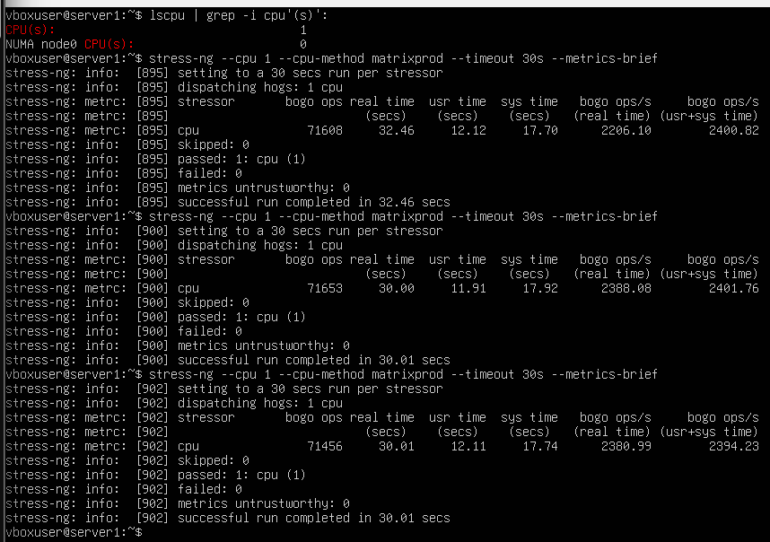
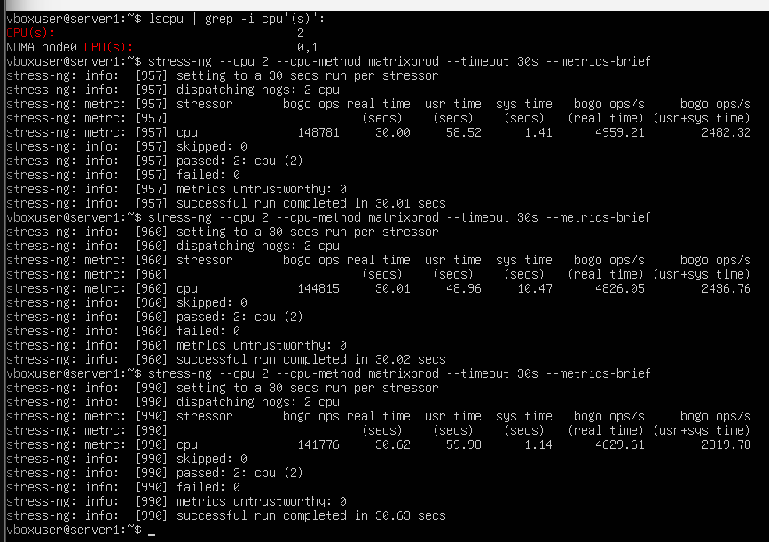
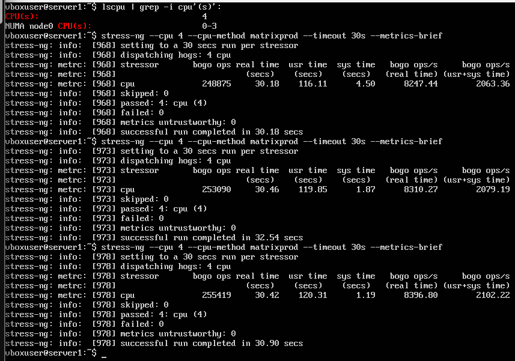
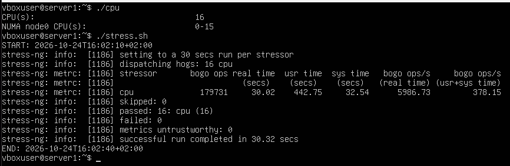
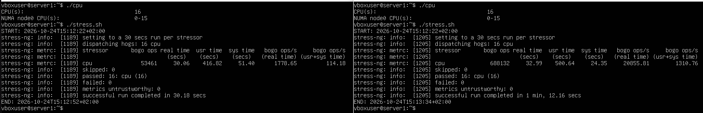
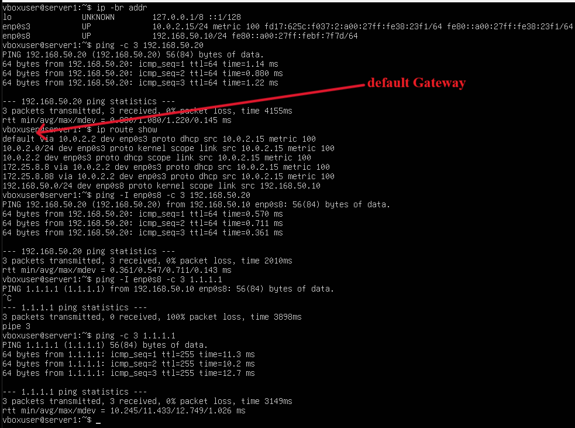

# Building VM's with type 2 hypervisor  

## Front page 

- Author
  - Roberto D'Arro (rd222kd@student.lnu.se)
  - Mussie Shifera Assefa (ms228qx@student.lnu.se)


- Submission date 
  - 09/28/2026

<!-- TOC -->

- [Part A — the machine](#part-a--the-machine)
  - [Tasks A1 (Install a type 2 hypervisor)](#tasks-a1-install-a-type-2-hypervisor)
  - [Tasks A2 ( Create the machine)](#tasks-a2--create-the-machine)
  - [Tasks A3 (inspect the four resources)](#tasks-a3-inspect-the-four-resources)
- [Part B — allocation](#part-b--allocation)
  - [Tasks B1 (Measure the vCPU count)](#tasks-b1-measure-the-vcpu-count)
  - [Tasks B2 (Produce contention)](#tasks-b2-produce-contention)
  - [Tasks B3 (Your consolidation ratio)](#tasks-b3-your-consolidation-ratio)
- [Reflection](#reflection)
- [Appendix](#appendix)

<!-- /TOC -->

## Part A — the machine 

### Tasks A1 (Install a type 2 hypervisor)

**Physical (host machine)**

The system has strong physical resources, including a 24-core CPU with 32 logical processors, approximately 16 GB of RAM, and a 954 GB NVMe SSD. At the time of measurement, CPU utilization was low at 2%, while memory usage was relatively high at 15.2 GB. The Ethernet interface was not connected but showed no active network traffic with specifically APIPA ip address of 169.254.32.42.

The chosen host machine under the type 2 hybervisor is Windows 11. 

- Host OS
  * window 11 version 25H2


Figure A.1.1: CPU 24 cores and 32 logical processer.

<br>


Figure A.1.2: RAM 16 GB.

<br>


Figure A.1.3: DISK 1 TB.

<br>


Figure A.1.4: Port Ethernet interface with APIPA and link local IP address.


Oracle VirtualBox is a premier choice as a Type 2 hypervisor for Windows 11 due to its zero-cost licensing, broad accessibility across Windows editions, and cross-platform portability. While Windows 11 includes a native virtualization platform (Hyper-V), VirtualBox serves as a highly flexible, application-level alternative. It is ideal for developers, students, and IT professionals who require rapid deployment of diverse operating systems without modifying the host’s core architecture. It create and run other operating systems—like Linux, macOS, or older Windows versions—as virtual machines right on your desktop.

- Type 2 hypervisor
  * virtualbox (7.2.2r170484) (where 170484 is the specific build number)

Alongside installing the hypervisor recommended to install the extension package this is usefull i.e NIC (network card interface) ability fot the guest machine.

### Tasks A2 ( Create the machine)

**Technical methodology for guest machine**

The standard procedure for creating a new Virtual Machine (VM) within Oracle VM VirtualBox. This process allows an administrator to isolate and run a guest operating system safely inside a host computer's existing environment.

The creation setup process for VMs involves configuring virtual hardware resources to mimic a physical computer through a five-step wizard:


Screenshot A.2.1: VM1, Initiating the wizard via the New button.

<br>

This is where the machine name, operating system distribution (ubuntu) and the CPU architecture of 64-bit is setup.


Screenshot A.2.2: VM1, Assigning machine name and location of ubuntu 24-04 ISO image.

<br>


Screenshot A.2.3: VM1, Setting up the username, hostname, domain name and password.

<br>

Hardware Allocation: Adjusting the allocation sliders to assign the host 8 GB RAM and 16 CPU cores to the virtual environment based on guest OS system requirements.


Screenshot A.2.4: VM1, Setting up 8 GB RAM and 16 CPU core.

<br>

Virtual Disk Provisioning: Setting up a virtual 50 GB hard disk using the Dynamically allocated format, ensuring host storage is only consumed as data is written within the VM.

Configuration Validation: Reviewing the hardware summary matrix before clicking Finish to build the virtual machine.


Screenshot A.2.5: VM1, Setting up 50 GB storage disk.

<br>

Setting up the virtual network is rather done through the setting button after completing the wizard.


Screenshot A.2.6: VM1, Configuring adaptor as NAT.


**Operational Benefits**

  - Resource Efficiency: Dynamic disk provisioning prevents immediate storage depletion on the host machine.

  - Environment Isolation: The guest OS operates inside a sandboxed layer, protecting the host system from potential malware or software instability.


### Tasks A3 (inspect the four resources)


> 1. command lscpu | grep -i hypervisor

- What the guest sees:

The guest sees a hypervisor vendor: KVM. It recognizes that its CPU execution is being managed by a virtualization layer.

- What it really is:

The guest is interacting with a virtualized CPU topology. The hypervisor intercepts specific CPU instructions (using hardware extensions Intel VT-x) and presents a simulated or pass-through subset of the physical host’s CPU capabilities to the guest.


Screenshot A.3.1.1: VM1, 16 cores of vCPU.


Screenshot A.3.1.2: VM1, Kernel-based virtualization module technology.

<br>

> 2. command free -h

- What the guest sees:

The guest sees a rigid, fixed amount of total, used, and available random-access memory (i.e Total: 1.9GiB). It acts as if it has exclusive, physical ownership of this address space.

- What it really is:

This memory is a slice of the host's physical RAM, mapped to the guest's virtual address space by the hypervisor. 

In reality, the host may use techniques like

  - memory ballooning (a virtualization technique that allows a physical host to reclaim unused RAM from virtual machines (VMs) and reassign it where it is needed.), 

  - page sharing, or overcommitting, meaning the physical RAM backing the guest can dynamically shift or be shared with other VMs.


Screenshot A.3.2: VM1, total primary memory size 2 GB. 

<br>

> 3. command lsblk

- What the guest sees:

The guest sees emulated SCSI/SATA drives (i.e sda and partion sda1 and sda2). It treats these as local, physical hardware drives.

- What it really is:

The sda disk is not a physical hard drive. It is a virtual disk file (most likely a .vdi or .vmdk file) stored on the host computer's actual drive. It is configured inside VirtualBox as a virtual SATA or SCSI controller storage device.

The sr0 drive is an ISO image file (such as a Linux installation disc or VirtualBox Guest Additions) mapped by the VirtualBox hypervisor to act like a physical disc inserted into a tray.


Screenshot A.3.3: VM1, secondary memory size sda 20 GB and no virtual memory.

<br>

> 4. command ip addr

- What the guest sees:

The guest sees local network interfaces (such as eth0, ens3, or enp0s3) assigned specific IP addresses, usually within a private subnet. It perceives these as dedicated network interface cards connected to a physical switch.

- What it really is:

The guest is using a Virtual Network Interface Card (vNIC) software-emulated by the hypervisor. This vNIC connects to a virtual bridge or switch inside the host's operating system, which multiplexes the traffic alongside other VMs over the host's actual physical network interface card (pNIC).


Screenshot A.3.4: VM1, NAT network topology with IP 10.0.2.15/24.

<br>

> 5. command systemd-detect-virt

- What the guest sees:

oracle: The guest operating system explicitly detects that it is running in an environment managed by Oracle. The system detects specific firmware parameters, DMI/SMBIOS motherboard strings, and hypervisor CPUID flags that identity the virtual hardware layer.

- What it really is:

Oracle VM VirtualBox: The hypervisor software running on the host machine is VirtualBox. When the virtual machine boots up, VirtualBox populates the guest's virtual BIOS/EFI system tables with identifying metadata (such as the system manufacturer string).

Detection Mechanism: The systemd-detect-virt command looks inside files like /sys/class/dmi/id/product_name and detect execution in a virtualized environment.


Screenshot A.3.5: VM1, detected it's running over oracle virtualbox.

<br>

## Part B — allocation 

### Tasks B1 (Measure the vCPU count)

**Experimental Methodology**

The objective of this task was to evaluate how virtual machine processing performance scales when modifying the allocated virtual CPU (vCPU) count.

1. System Provisioning: The virtual machine was shut down sequentially to modify the vCPU configuration in the hypervisor settings to 1 vCPU, 2 vCPUs, and 4 vCPUs.

2. Execution: For each hardware configuration, the matrixprod CPU stress method was executed using stress-ng. This specific method stresses the CPU by performing intensive matrix multiplications, isolating raw computational throughput.

3. Consistency Constraints: Each configuration was tested 3 separate times for a duration of 30 seconds to minimize background noise and ensure statistical reliability.

```bash
stress-ng --cpu N --cpu-method matrixprod --timeout 30s --metrics-brief
```

**Note**: Where N represents the respective vCPU allocation: 1, 2, or 4.

|      Options      |                            Expanationn                                |
|       :---:       |                               :---:                                   |
| --cpu 4 	        | Starts four CPU stress workers.                                       |
| --cpu-method      | matrixprod	Uses matrix multiplication as the CPU-intensive workload. |
| --timeout 30s	    | Runs the stress workload for approximately 30 seconds.                |
| --metrics-brief   | Displays summarized performance statistics.                           |



Screenshot B.1.1: completed operation on VM1, with 1 vCPU stressed for 30 seconds.


Screenshot B.1.2 The spike of the cpu usage in the host machine, when VM1 with stressed with vCPU of 1

<br>



Screenshot B.1.3: completed operation on VM1, with 2 vCPU stressed for 30 seconds.


Screenshot B.1.4 The spike of the cpu usage in the host machine, when VM1 with stressed with vCPU of 2

<br>



Screenshot B.1.5: completed operation on VM1, with 4 vCPU stressed for 30 seconds.


Screenshot B.1.6 The spike of the cpu usage in the host machine, when VM1 with stressed with vCPU of 4

<br>

**Bogo ops**

- It is the number of workload-specific operations completed, not the amount of CPU stress itself.

In this experiment, the operations are associated with the matrixprod stress method, which repeatedly performs matrix multiplication. For example, the first 1-vCPU test completed 71,608 bogo operations, while the first 4-vCPU test completed 248,875.

This demonstrates that the four-worker configuration completed substantially more work within approximately the same period. However, bogo operations are not equivalent to CPU instructions or floating-point operations and should not be interpreted as an absolute measure of processor performance.

**Real time**

- It is the actual elapsed wall-clock time from the start to the end of the measured workload, including waiting and scheduling delays.

For example, the first 1-vCPU test reported 32.46 seconds, even though the requested timeout was 30 seconds. This difference can result from workload termination delays (Scheduling delays in the virtual machine), scheduling, or other execution overhead (CPU contention). The reported real time is the value used to calculate real-time throughput.

**User time (usr time)**

- It is the total CPU execution time spent in user mode by all stress workers, excluding kernel-mode CPU time.

For example, the first 4-vCPU test reported 116.11 seconds of user time during approximately 30 seconds of real time. This is possible because four CPU workers execute concurrently. If four workers each consume approximately 30 seconds of CPU time, their combined CPU time can approach 120 seconds.

Therefore, user time is cumulative across the workers rather than simply the elapsed duration.

**System time (sys time)**

- System time represents the cumulative CPU time spent executing kernel-mode operations on behalf of the workload.

These operations can include system calls, memory-management activities, and other kernel processing.

In the first 1-vCPU test, system time was 17.70 seconds, compared with 12.12 seconds of user time. In the first 4-vCPU test, system time was only 4.50 seconds, while user time was 116.11 seconds.

This indicates a significant difference in where CPU execution time was spent. The measurements alone do not establish the exact reason, but differences in the workload's execution path, scheduling, or runtime environment could contribute.

**Bogo ops/s (real time)**

- This metric measures the number of bogo operations completed per second of elapsed wall-clock time.

Bogo ops/s = Total bogo ops / Real time

This metric is particularly useful for comparing total throughput between different vCPU configurations.

**Bogo ops/s (usr+sys time)**

- This metric measures the number of bogo operations completed per second of accumulated CPU execution time.

Bogo ops/s = Total bogo ops / (User time + System time)

Unlike real-time throughput, this metric accounts for the combined CPU time consumed by all workers. It is useful for examining how efficiently CPU execution time is converted into completed workload operations.

**Collected Data and Metrics**

The table below outlines the computational throughput measured in bogo-ops/s (bogus operations per second) across all nine iterations.

| vCPU Configuration | Run 1 (bogo-ops/s) | Run 2 (bogo-ops/s) | Run 3 (bogo-ops/s) | Average Throughput (bogo-ops/s) |
|:---                |        :---:       |        :---:       |        :---:       |                             ---:|
| 1 vCPU	           | 2,206.10	          | 2,388.08           | 2,380.99	          | 2,325.05                        |
| 2 vCPUs	           | 4,959.21	          | 4,826.05	         | 4,629.61	          | 4,804.95                        |
| 4 vCPUs	           | 8,247.44	          | 8,310.27	         | 8,396.61	          | 8,318.10                        |

Table B.1 this the average throughput of all the vCPU configurations. 

Analysis: The results show that increasing the number of vCPUs improves the total computational throughput. The 2-vCPU configuration achieved approximately 2.07 times the throughput of the 1-vCPU configuration, indicating nearly linear scaling. However, the 4-vCPU configuration achieved only 3.58 times the throughput of the 1-vCPU configuration.

The reduction in scaling efficiency at four vCPUs may be caused by contention for shared CPU resources, hypervisor scheduling overhead, or changes in processor frequency under higher load. The benchmark results alone do not establish the exact cause.

The experiment demonstrates that increasing the number of vCPUs generally improves performance for parallel CPU-intensive workloads. However, the improvement is not necessarily proportional to the number of vCPUs. The 4-vCPU configuration achieved the highest total throughput, while the 2-vCPU configuration showed the highest average throughput per vCPU. The measurements illustrate both the benefits and limitations of parallel processing in virtualized environments.

<br>

### Tasks B2 (Produce contention)

**Experimental Setup & Methodology**

The objective of this task was to analyze the performance impact of CPU resource contention by simulating two virtual machines competing for the same underlying physical hardware.

1. System Provisioning: Two identical virtual machines (Guest 1 and Guest 2) were configured, each allocated 16 vCPUs and 8 GB RAM.

2. Baseline Test (Isolated): Guest 1 was booted alone while Guest 2 was entirely powered off. The benchmark tool stress-ng was executed to measure peak isolated performance.

3. Contention Test (Concurrent): Both Guest 1 and Guest 2 were powered on simultaneously. The benchmark command was initiated on both machines at the exact same time to force resource competition.

```bash
stress-ng --cpu 16 --cpu-method matrixprod --timeout 30s --metrics-brief
```

 

Screenshot B.2.1 VM1, running the stree worker


Screenshot B.2.3 VM1, running the stress worker with 16 cores creating a spike on host machine.



Screenshot B.2.2 both VM1 and VM2, running the stress worker.
 


Screenshot B.2.3 both VMs, running the stress worker with 16 cores each creating a spike on host machine.

**Collected Data & Benchmark Metrics**

The throughput metrics below reflect the computational output measured in bogo-ops/s (bogus operations per second) for both scenarios.

| Test Scenario           |	Guest 1 Throughput (bogo-ops/s)	| Guest 2 Throughput (bogo-ops/s) |	Total Aggregate Throughput |
|:---                     |                :---:            |              :---:              |                        ---:|
| Test 1: Guest 1 Alone	  |          5,986.73               |          Powered Off	          |           5,986.73         |
| Test 2: Concurrent Load |	         1,778.65	              |          20,855.81	            |           22,634.46        |

Table B.2 throughput when both virtual machines run simultaneously

**Observations**

The experiment evaluated CPU contention by running the stress-ng matrix multiplication workload on two Ubuntu virtual machines.

When Guest 1 was running alone, it achieved a throughput of 5,986.73 bogo-ops/s. During simultaneous execution with Guest 2, its throughput decreased to 1,778.65 bogo-ops/s, representing severe performance reduction of approximately 70.29%.

(5986.73-1778.65)/(5986.73) * 100% = 70.29%

Guest 2 achieved 20,855.81 bogo-ops/s during concurrent execution, resulting in a combined aggregate throughput of 22,634.46 bogo-ops/s. This represents a 278.07% increase compared with Guest 1's standalone throughput.

(22634.46-5986.73)/(5986.73) * 100% = 278.07%

The elapsed time between the script timestamps is approximately (1 min, 12.16 secs) 72 seconds, despite the stressor reporting only 32.99 seconds of real time. This means the overall command took much longer than the stressor's measured workload interval.

The concurrent test was recorded with matching start timestamps of 15:12:22, providing evidence that the benchmark command intervals overlapped.

The substantial decrease in Guest 1's throughput is consistent with resource contention. However, had a experienced kernel `soft-lockup` warnings and abnormal execution times suggest that virtualization instability may also have affected the results. Therefore, the observed performance reduction cannot be attributed exclusively to CPU contention.


Screenshot B.2.4 abnormal execution times suggest that virtualization instability

<br>

### Tasks B3 (Your consolidation ratio)

Four virtual machines were configured with 8 vCPUs, 4 GB RAM, and 25 GB virtual disk capacity each. The physical host has 24 CPU cores (32 logical processors), 16 GB RAM, and a 1 TB NVMe SSD with 35 GB of available storage.

| Resource Type  |  per VM  | Total Promised (All VMs) | Host Hardware (Physical)   | Consolidation Ratio	          | Overcommitted  |
|:---            |  :---:   |          :---:           |           :---:            |             :---:             |            ---:|
| CPU (Cores)	   | 8 vCPUs  | 32 vCPUs	  	           | 24 Cores / 32 Threads      | 1.33 : 1 (vCPU to Core)	      |    yes         |
| Memory (RAM)	 |   4 GB   | 16 GB RAM	               | 16 GB RAM                  | 1 : 1 (Promised to Physical)  |    No          |
| Storage (Disk) |  25 GB   | 100 GB Virtual Disk      | 1 TB NVMe SSD (35 GB free) | 2.86 : 1 (Allocated to free)  |    yes         |

Table B.3 consolidation ratio between the Promised Allocation Metrics vs Host


Screenshot B.3.1

The CPU consolidation ratio is 32:24, or 1.33:1, indicating CPU overcommitment relative to physical cores. The memory consolidation ratio is 16:16, or 1:1, while the disk commitment ratio is 100:35, or 2.86:1, relative to available free storage.

Consolidation allows multiple virtual machines to share physical resources, improving hardware utilization and reducing infrastructure costs. However, it also introduces risks such as CPU contention, memory pressure, and storage exhaustion.

Memory is the most likely initial runtime bottleneck because the virtual machines collectively request all 16 GB of installed physical RAM, leaving no dedicated capacity for Windows 11 or virtualization overhead. This could result in excessive paging, degraded performance, or an inability to start all four VMs.

Storage presents another significant risk because the total promised virtual disk capacity exceeds the available free space. Dynamically allocated virtual disks may initially consume less space, but continued growth could eventually exhaust the host's storage.

CPU overcommitment is primarily a performance risk rather than an immediate hard capacity limit because virtual CPUs can share physical execution resources through hypervisor scheduling.

Therefore, memory is predicted to become the first practical runtime constraint, while disk storage represents the most significant provisioned-capacity risk.

<br>

## Reflection 

**Analytical Evaluation & Deployment Arguments**

Benefits of Resource Overcommitment (What it Buys)

- Capital Efficiency: Maximizes hardware utilization by capitalizing on the fact that idle VMs do not fully exhaust their allocated footprints simultaneously.

- Density & Scalability: Allows organizations to host more workloads on fewer physical servers, directly lowering power, cooling, and hardware procurement costs.

Risks of Resource Overcommitment (What it Risks)

- The "Noisy Neighbor" Effect: If multiple VMs spike in resource utilization simultaneously (as simulated in Task B2), the hypervisor struggles to allocate physical cycles, degrading overall performance.

- System Instability: Extreme memory overcommitment can force the host to swap to disk, drastically slowing down operations or triggering the Out-Of-Memory (OOM) killer, which terminates active processes.

## Network

This shows main concept difference between Layer 2 communication within a private network and Layer 3 routing to external networks.


| Adapter	   |           Guest A          |           Guest B         |
|  :---:     |           :---:            |            :---:          | 
| Adapter 1  |          NAT	              |           NAT             |
| Adapter 2  |	Internal Network (intnet) |	Internal Network (intnet) |
| Private IP |  192.168.50.10/24          | 192.168.50.20/24          |

Table B.4 network configuration topology for each guests.



Screenshot B.3.2 successful ping to the neighbour (192.169.50.20).

From Guest A, test Guest B:

```bash
ping -I enp0s8 -c 3 192.168.50.20
```

Expected: Successful replies because both guests belong to the same private subnet and virtual switch. ARP resolves Guest B's MAC address, and frames are delivered directly without a router.

Next, test internet connectivity through the private adapter:

```bash
ping -I enp0s8 -c 3 1.1.1.1
```

Expected: Failure because the private internal network has no router or internet gateway. Depending on routing configuration, the result may be Network is unreachable or another connectivity failure.

Finally, test the internet normally:

```bash
ping -c 3 1.1.1.1
```

Expected: Successful replies through Adapter 1 (NAT), assuming the NAT connection is working.

The default route should normally point through the NAT adapter, while the private subnet has a directly connected route through the internal adapter.

<br>

## Appendix

Part A task 3:

```bash

sudo cat /proc/meminfo | grep MemTotal

sudo cat /sys/class/dmi/id/product_name

```

Part B task 2:

This commands were used to used to show the contention between the to VMs.


